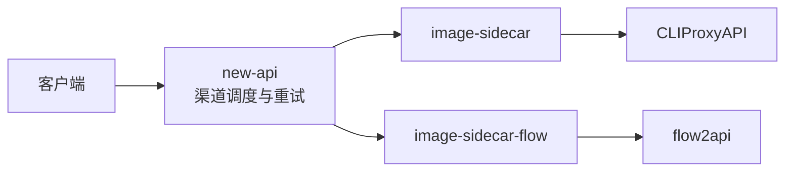

# new-api → CLIProxyAPI / flow2api 图片转换 sidecar

在 OpenAI `/v1/chat/completions` 请求进入 CLIProxyAPI 或 flow2api 前，将白名单域名的远程 `image_url` 下载为原始图片字节，并替换为 `data:<MIME>;base64,...`。两个上游共用相同的转换和安全限制；只处理请求图片，不改写模型响应。



## 部署

### 使用完整双上游示例

1. `cp .env.example .env`。
2. 在 `.env` 中设置四个独立随机密钥/密码和图片域名白名单。可用 `openssl rand -hex 32` 生成随机值。
3. 将现有 CLIProxyAPI 认证文件放入 `./auths`，或把 Compose 中该卷改为已有认证目录。全新空目录不代表已经完成模型授权。
4. 执行 `docker compose up -d --build`。
5. 打开 `http://127.0.0.1:<FLOW2API_PORT>`（默认 `http://127.0.0.1:38000`），使用 `admin` 和 `FLOW2API_ADMIN_PASSWORD` 登录 flow2api，添加 Flow Token 并配置验证码服务。远程主机可通过 SSH 隧道访问该回环端口。

Compose 将 new-api 的 `${NEW_API_PORT:-3000}` 发布到宿主机，并将 flow2api 管理/API 端口仅绑定到 `127.0.0.1:${FLOW2API_PORT:-38000}`；CLIProxyAPI 和两个 sidecar 只在容器内网暴露。flow2api 使用 [TheSmallHanCat/flow2api](https://github.com/TheSmallHanCat/flow2api) 官方镜像，数据与缓存保存在 `./flow2api/`。已有 SQLite 数据会恢复运行配置；修改 TOML 不一定会覆盖已有 API Key 或管理员设置，此时以后台实际配置为准。

已有服务可合并两个 sidecar 定义，并让它们的 `CLIPROXYAPI_URL` 分别指向 CPA 和 flow2api 根地址。所有上游与 sidecar 必须使用同一容器网络。两个 sidecar 的 `depends_on` 也必须同步改为实际上游服务名；上游不由该 Compose 管理时，删除对应依赖。保留 `service_healthy` 条件时，现有 flow2api 服务还必须配置等价健康检查。白名单只接受逗号分隔的**精确主机名**，不要填写 scheme、路径、端口或通配符；每个重定向目标域名也必须单独列入。

示例请求需要：

```dotenv
IMAGE_HOST_ALLOWLIST=pgw.udn.com.tw,oss-cdn.i2tools.com
```

## new-api 渠道

| 渠道 | 类型 | Base URL | API Key |
|---|---|---|---|
| CLIProxyAPI | `OpenAI`（类型 1） | `http://image-sidecar:8080` | 与 `CLIPROXYAPI_API_KEY` 相同 |
| flow2api | `OpenAI`（类型 1） | `http://image-sidecar-flow:8080` | 与 `FLOW2API_API_KEY` 相同 |

Base URL 不带 `/v1` 或末尾 `/`。两个渠道启用相同的对外模型名，并按需要在 new-api 中设置渠道权重、优先级和重试；路由只由 new-api 负责。模型同名直转时映射留空，不同时分别配置映射。客户端仍请求 new-api 的 `/v1/chat/completions`，使用 new-api 签发的客户端 Key；原请求结构无需修改。跨渠道重试会重新执行对应 sidecar 的图片下载。

## 环境变量

| 变量 | 默认值 | 说明 |
|---|---|---|
| `LISTEN_ADDR` | `:8080` | sidecar 监听地址 |
| `CLIPROXYAPI_URL` | `http://cli-proxy-api:8317` | sidecar 上游根地址；Compose 中分别指向两个上游 |
| `IMAGE_HOST_ALLOWLIST` | 无；Compose 占位为 `images.example.com` | 两个实例共用，逗号分隔的精确图片域名 |
| `FLOW2API_API_KEY` | 无 | 注入 flow2api `setting.toml`，同时作为其 new-api 渠道 Key |
| `FLOW2API_ADMIN_PASSWORD` | 无 | flow2api 初始管理员密码 |
| `FLOW2API_PORT` | `38000` | flow2api 在宿主机回环地址上的管理/API 端口 |

## 转换与失败语义

- 只遍历 `messages[].content[]` 中的 `image_url`；文本、图片顺序、`detail`、模型和其他字段保持不变。
- 已有 `data:` URL 原样保留。HTTP/HTTPS 图片以原始字节 Base64 编码，不解码、不缩放、不压缩。
- 支持 JPEG、PNG、WebP、HEIC、HEIF；响应声明与实际 sniff 结果不一致时拒绝。
- 只允许白名单域名和公网 IP；阻止私网、回环、链路本地、保留地址及 DNS 重绑定。
- 图片请求不继承模型 API Key、Authorization 或 Cookie；签名 URL query 可以下载，但不写入日志。
- 其他 HTTP 路径直接反向代理；SSE 响应逐块透传。
- 任一选中的图片失败都在调用目标上游前终止整个请求，不删图、不降级。

flow2api 还会从历史 assistant 字符串的 Markdown 图片 URL 下载参考图，这条路径不经过 sidecar。接受不可信多轮消息时，应在进入 flow2api 前拒绝此类 URL 或禁用该功能，不能把它视为已受 sidecar 白名单保护。

默认限制定义在 `sidecar.go`：入站 JSON 32 MiB、8 张远程图片、单图 10 MiB、图片原始字节合计 20 MiB、4 路下载并发、单图 15 秒、整批 45 秒、最多 5 次重定向。Base64 后的出站体积会更大。

常见错误：

| HTTP | 错误码 | 原因 |
|---|---|---|
| 400 | `invalid_image_url` | scheme、URL 或用户信息不合法 |
| 400 | `image_host_not_allowed` | 初始或重定向域名不在白名单 |
| 400 | `image_target_not_allowed` | 域名解析到非公网地址 |
| 400 | `unsupported_image_type` | 类型不支持或内容与声明不符 |
| 413 | `image_too_large` / `images_too_large` | 单图或总字节超限 |
| 502 | `image_download_failed` | 图片服务器非成功状态或网络失败 |
| 504 | `image_download_timeout` | 图片下载或整批处理超时 |

## 验证

```sh
docker compose config --quiet
go test ./...
# 没有本机 Go 时，镜像构建会在 builder 阶段运行同一测试集：
docker compose build image-sidecar image-sidecar-flow
```

CLIProxyAPI 的 Gemini 转换路径依据见 `new-api-cliproxyapi-research.md`；flow2api 的指定 fork 部署与协议依据见 `flow2api-new-api-research.md`。
